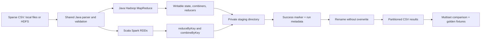
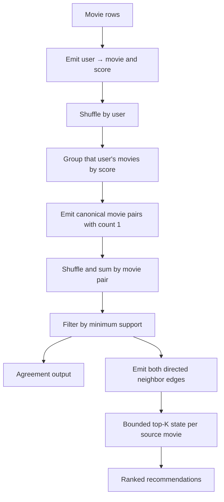

# Ratings Lab

**Distributed movie analytics in Java Hadoop MapReduce and Scala Apache Spark.**

[](https://github.com/jayhuangsci/distributedSysUtilsDemo/actions/workflows/ci.yml)


[](LICENSE)

Turn a sparse movie-rating matrix into movie statistics, user activity, agreement scores, and ranked item recommendations. Run the same seven commands on two execution engines, then compare their results automatically.

**Project objective:** demonstrate how to design, implement, and verify a distributed batch pipeline: partitioning, associative aggregation, shuffle joins, bounded ranking state, input validation, and safe publication of results. This project develops the original unfinished movie-rating exercises into a runnable engineering portfolio.

## Run the complete demo

On Linux or macOS, install **JDK 11** and **unzip**, and set `JAVA_HOME`. The wrapper downloads Maven 3.9.11 and verifies its ZIP checksum; no Hadoop or Spark installation is required for local execution. Allow roughly 2 GB of JVM heap plus operating system overhead. The first build downloads the engine libraries.

```bash
git clone https://github.com/jayhuangsci/distributedSysUtilsDemo.git
cd distributedSysUtilsDemo
./mvnw --batch-mode verify
./scripts/run.sh demo sample_input/smalldata.txt demo-output/sample 2 1
cat demo-output/sample/report.csv
```

The demo runs every command on Hadoop's local runner and Spark `local[2]`, compares every output record, and writes timings and verification status to `report.csv`. Each engine output also includes `_SUCCESS` and `_RUN.json`. Choose a new output directory for another run; existing results are protected from overwrite.

**Windows:** the parser, generator, comparator, and build work with JDK 11 and `mvnw.cmd`. Use the Linux container below for engine execution, or run the Bash commands in WSL2. Native Hadoop filesystem operations require Windows native binaries, which this repository does not bundle. Integration tests explicitly skip on native Windows and run on Linux CI.

```powershell
.\mvnw.cmd --batch-mode verify
.\scripts\run.ps1 generate --movies 100 --users 20 --density 0.2 --seed 42 --output target\ratings.csv
```

### Run with Docker

Docker Desktop with Linux containers works on Windows and macOS; Docker Engine works on Linux. The image builds the application and includes its runtime dependencies.

```bash
docker build -t ratings-lab .
docker run --rm ratings-lab
```

That command runs the complete sample demo inside the container. To keep results locally:

```bash
mkdir -p demo-output
docker run --rm --mount "type=bind,source=$(pwd)/demo-output,target=/results" ratings-lab
```

PowerShell equivalent for the mounted run:

```powershell
New-Item -ItemType Directory -Force demo-output | Out-Null
docker run --rm --mount "type=bind,source=$($PWD.Path)\demo-output,target=/results" ratings-lab
```

Results appear under `demo-output/sample/`. Use a different destination on subsequent runs, for example `docker run --rm ratings-lab demo sample_input/smalldata.txt /results/another-run 2 1`.

## What is implemented

All commands are available in **both** engines.

| Command | Result schema, without a header | Behavior |
| --- | --- | --- |
| `top-raters` | `movie,user_id,...` | Users giving each movie its highest observed score; ties use ascending numeric user ID. Original Task 1. |
| `total` | `rating_count` | Number of nonempty ratings across the input. Original Task 2. |
| `user-counts` | `user_id,rating_count` | Activity for each user with at least one rating. Original Task 3. |
| `agreement` | `movie_a,movie_b,support` | Number of shared users giving the two movies **the same score**. Original Task 4. |
| `movie-stats` | `movie,count,sum,mean,min,max` | Exact integer aggregate state and a mean formatted to six decimal places. |
| `recommend` | `movie,neighbor,support,rank` | Top-K neighbors by agreement support; ties use ascending title. |
| `word-count` | `token,count` | Unicode letter/number tokens, case normalization, and whitespace/punctuation handling. |

Recommendations are explainable item-to-item neighbors based on agreement counts. They are a batch analytics demonstration; no personalization or recommendation-quality evaluation is claimed.

### Example results

The supplied three-movie input contains **13 ratings**. `movie-stats` produces these records, shown in title order:

```csv
Apocalypto,5,21,4.200000,3,5
Apollo 13,3,14,4.666667,4,5
The Lord of The Rings,5,18,3.600000,2,5
```

With `--top-k 1`, `recommend` produces:

```csv
Apocalypto,Apollo 13,1,1
Apollo 13,Apocalypto,1,1
The Lord of The Rings,Apocalypto,1,1
```

Output files are partitioned and are not globally sorted. Rank is an explicit field. The comparator ignores record order while preserving duplicate counts. See [verified edge-case examples](docs/examples/) for quoted titles and unrated movies.

## Architecture



The movie-pair pipeline joins by **user**, so movies can originate in different input files or partitions:



Hadoop uses two jobs for agreement and three for recommendations, with a SequenceFile intermediate between the user join and pair aggregation. Spark expresses the equivalent operations as RDD transformations. Neither implementation collects the full rating matrix on the driver. [Design details and complexity](docs/design.md).

## Use individual commands

```bash
./scripts/run.sh hadoop --task movie-stats \
  --input sample_input/smalldata.txt --output demo-output/hadoop-stats --partitions 3

./scripts/run.sh spark --task movie-stats \
  --input sample_input/smalldata.txt --output demo-output/spark-stats --partitions 3

./scripts/run.sh compare demo-output/hadoop-stats demo-output/spark-stats

./scripts/run.sh spark --task recommend \
  --input sample_input/smalldata.txt --output demo-output/neighbors \
  --partitions 3 --top-k 1 --min-support 1
```

`scripts/run.sh` starts a separate JVM with the resolved Maven runtime classpath. It builds automatically when artifacts are missing. After changing source code, run `./mvnw verify` to rebuild. `scripts/run.ps1` exposes the same command names for Windows environments with the required runtime support.

| Option | Default | Purpose |
| --- | --- | --- |
| `--task`, `--input`, `--output` | Required | Operation, input file/directory, and a new destination. |
| `--partitions` | `2` | Hadoop reducer count or Spark shuffle partition count. `total` always emits one scalar. |
| `--top-k` | `3` | Maximum neighbors per source movie. |
| `--min-support` | `1` | Minimum agreement count, applied before ranking. |
| `--max-movies-per-user` | `10000` | Fail the pair join if a user's distinct movie count exceeds this bound. |
| `--bad-records` | `fail` | Either abort on an invalid row or `skip` the entire row and count it. |

`--help` prints the analytics arguments. Hadoop also accepts standard generic `-D` configuration options before the application arguments.

## Input contract

```csv
Apocalypto,3,5,4,,5,4
Apollo 13,,,4,5,,5
"Film, with a comma",5,,4
```

- Headerless UTF-8 CSV, one complete movie record per line, with a **unique movie title** per input dataset.
- Column 1 is the title. Each subsequent column represents a one-based user ID; empty values mean missing ratings. User IDs preserve empty column positions.
- Scores are integers from 1 through 5. Missing fields, quoted commas, escaped double quotes, and varying row widths are supported. Titles and rating fields are trimmed.
- Embedded newlines in titles are unsupported. An invalid field rejects the whole row. Unrated movies are valid: statistics are zero and `top-raters` emits only the title.
- Empty input has a total of zero; other tasks emit no records. Movies without qualifying neighbors do not appear in recommendation output.
- Title uniqueness is an input requirement. The pair join rejects duplicate movie entries for the same user; this is not a global duplicate-title validation pass.

The bundled data is the repository's original small fixture. The generator creates synthetic data in this schema; no external dataset or account is required.

## Generate data and measure a run

```bash
./scripts/run.sh generate --movies 1000 --users 100 --density 0.1 \
  --seed 42 --output demo-output/generated.csv

# Reuse one Spark context, run each task three times, and verify every result.
./scripts/run.sh demo demo-output/generated.csv demo-output/experiment 4 3

# Or generate a fresh dataset and experiment directory in one command:
./scripts/benchmark.sh 1000 100 0.1 3 4
```

Generator arguments are movie count, user count, density, and seed. Benchmark script positional arguments are `movies users density repetitions partitions`. Reports include measured milliseconds, partition count, output cardinality, and `MATCH` status. Hadoop run metadata adds input-quality counters, combiner records, shuffle bytes, and stage durations.

These are **local measurements**, with a reused Spark context and engine startup/cache effects. They do not establish cluster throughput or a speedup claim. Pair generation can be quadratic in a user's movie count; inspect your input distribution before increasing dataset size or the guard limit.

## HDFS and YARN

The same application accepts HDFS URIs. Build the application JAR, then submit to an existing, configured Hadoop/Spark cluster:

```bash
./mvnw --batch-mode -DskipTests package

hdfs dfs -mkdir -p /user/$USER/ratings-lab/input
hdfs dfs -put sample_input/smalldata.txt /user/$USER/ratings-lab/input/sample.csv

hadoop jar target/ratings-lab-1.0.0.jar \
  io.github.jayhuangsci.ratings.hadoop.HadoopAnalytics \
  -Dmapreduce.framework.name=yarn -Dmapreduce.map.output.compress=true \
  --task movie-stats --input hdfs:///user/$USER/ratings-lab/input \
  --output hdfs:///user/$USER/ratings-lab/hadoop-stats --partitions 4

spark-submit --master yarn --deploy-mode cluster \
  --class io.github.jayhuangsci.ratings.spark.SparkAnalytics \
  target/ratings-lab-1.0.0.jar \
  --task recommend --input hdfs:///user/$USER/ratings-lab/input \
  --output hdfs:///user/$USER/ratings-lab/spark-neighbors \
  --partitions 4 --top-k 3 --min-support 1

hdfs dfs -cat /user/$USER/ratings-lab/spark-neighbors/part-\*
```

Cluster dependencies are supplied by Hadoop and Spark; the application JAR does not package the engines. Use a compatible Java 11 / Spark 3.5 / Scala 2.12 environment and configure `HADOOP_CONF_DIR`. **CI verifies real local runners and the Linux container. It does not provision or test a multi-node YARN cluster.** See [operations and troubleshooting](docs/operations.md) for configuration and output guarantees.

## Verification and repository guide

`./mvnw verify` runs JUnit tests for parsing, merge algebra, ranking ties, reproducible generation, result comparison, original golden fixtures, both engines, failure cleanup, support thresholds, and partition independence. The Linux workflow also executes the documented demo, a generated-data experiment, the benchmark script, and the container demo. It uploads results and run metadata as `verification-evidence`.

| Path | Contents |
| --- | --- |
| `src/main/java/.../core/` | Shared schema, CSV parser, statistics, tokenization, CLI options, bounded ranking. |
| `src/main/java/.../hadoop/` | MapReduce jobs, custom Writable, transactional output. |
| `src/main/scala/.../spark/` | Scala Spark analytics. |
| `src/main/{java,scala}/.../tools/` | Generator, comparator, demo/experiment runner. |
| `sample_input/`, `sample_output/` | Original data and four expected results. |
| `src/test/` | Unit tests, integration tests, edge-case fixtures, independent reference calculations. |
| `docs/` | Design, operations, examples, and [resume/interview notes](docs/portfolio.md). |

The old root-level task stubs and machine-specific scripts have been replaced by these working commands. Their history remains in Git. This is an educational batch-processing project with explicit resource limits, not a production service or a claim of large-scale deployment.

## Technical references

- [Hadoop MapReduce tutorial](https://hadoop.apache.org/docs/r3.4.2/hadoop-mapreduce-client/hadoop-mapreduce-client-core/MapReduceTutorial.html)
- [Spark 3.5.7 runtime requirements](https://spark.apache.org/docs/3.5.7/)
- [Spark RDD programming guide](https://spark.apache.org/docs/3.5.7/rdd-programming-guide.html)
- [Hadoop Java compatibility](https://cwiki.apache.org/confluence/display/HADOOP/Hadoop+Java+Versions)

MIT licensed. See [LICENSE](LICENSE).
