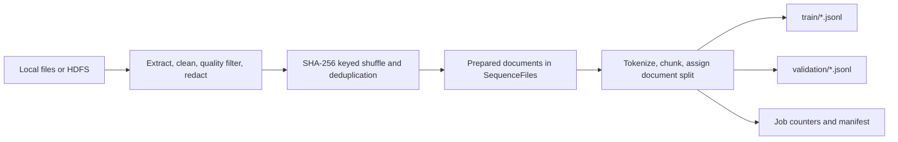

# Hadoop Corpus Pipeline

**Java and Hadoop MapReduce: raw text → cleaned, deduplicated training JSONL.**

This project's objective is to prepare large collections of independent text documents for AI pretraining workflows. Two MapReduce jobs extract plain text or HTML, normalize and filter noise, redact common sensitive patterns, deduplicate across input shards, and export overlapping lexical-token chunks as JSONL.



Build with JDK 11 and unzip on Linux/macOS:

```bash
./mvnw --batch-mode verify
./scripts/run.sh demo sample_input/raw-documents.txt demo-output/sample
./scripts/run.sh generate --documents 1000 --shards 8 --output demo-output/raw
./scripts/run.sh prepare --input demo-output/raw --output demo-output/corpus --reducers 3
./scripts/run.sh inspect demo-output/corpus
```

Native Windows can build and run the generator; use Linux containers or WSL2 for Hadoop execution. A local container demo is available:

```bash
docker build -t hadoop-corpus .
docker run --rm hadoop-corpus
```

Each JSONL record contains clean `text`, lexical `tokens`, stable chunk/document IDs, token offsets, redaction counts, and hashed source provenance. Document IDs determine the train/validation split, keeping all copies and chunks of one normalized document together. Tokens are model-independent lexical units, not a model's BPE IDs. Redaction is heuristic and does not guarantee complete anonymization.

`prepare --help` lists quality, input-mode, chunking, compression and resource options. Default input is one document per UTF-8 line; `--input-mode files` reads one bounded document per file, including multiline HTML. Gzip inputs and JSONL gzip output are supported. Results publish only after both jobs succeed; existing destinations are never overwritten.

The previous Scala/Spark ratings project is preserved at [ratings-lab-v1.0.0](https://github.com/jayhuangsci/distributedSysUtilsDemo/tree/ratings-lab-v1.0.0). Scala/Spark is no longer part of the main build.
