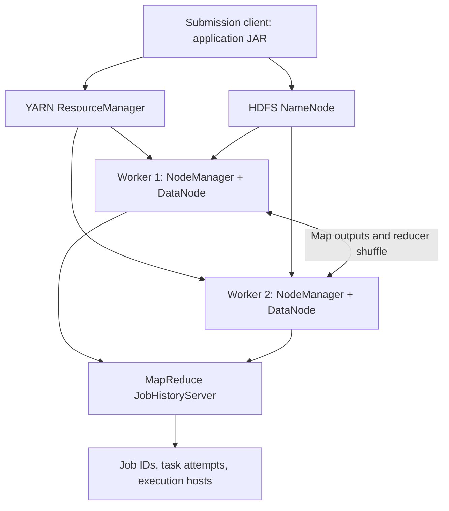

# Hadoop Corpus Pipeline

**Distributed raw-text preparation for AI training datasets, built with Java, Hadoop MapReduce, HDFS, and YARN.**

[](https://github.com/jayhuangsci/distributedSysUtilsDemo/actions/workflows/ci.yml)


[](LICENSE)

**Objective:** turn many raw text documents into consistent, cleaned JSONL training examples through distributed computation. Java MapReduce handles extraction, normalization, noise filtering, common-pattern redaction, global exact deduplication, tokenization, and chunk export. HDFS stores input and output; YARN schedules the workers.

The project implements the data-preparation portion of an AI training workflow. It produces pretraining text records with metadata and lexical tokens; it does not generate instruction/answer labels or train a model.

## Pipeline

```mermaid
flowchart LR
    Raw["HDFS raw text / Hive TEXTFILE location"] --> Extract["Extract plain text or HTML"]
    Extract --> Clean["Normalize and remove boilerplate"]
    Clean --> Redact["Redact common sensitive patterns"]
    Redact --> Quality["Apply document quality rules"]
    Quality --> Shuffle["SHA-256 keyed shuffle"]
    Shuffle --> Dedup["Reducers: global exact deduplication"]
    Dedup --> Sequence["Prepared SequenceFiles"]
    Sequence --> Tokenize["Map-only: tokenize and chunk"]
    Tokenize --> Split["Document-based train/validation split"]
    Split --> JSON["Partitioned JSONL or JSONL.gz"]
    JSON --> Publish["Success marker, manifest, no-overwrite publish"]
```



There are **two MapReduce jobs**: prepare/deduplicate, then tokenize/export. Redaction happens before content hashing so copies that differ only in masked values can collapse into one document. No complete corpus is collected in the submission client.

## Run on a two-worker HDFS/YARN cluster

Install Docker with Linux containers and Docker Compose. Allocate approximately **6 GB of memory** for the demo cluster. The first build downloads and checksum-verifies Apache Hadoop 3.4.2.

```bash
docker compose -f deploy/compose.yml build namenode
docker compose -f deploy/compose.yml up --detach --no-build --wait --wait-timeout 180
docker compose -f deploy/compose.yml run --rm client /opt/demo/cluster-demo.sh
```

The demo generates **80 synthetic documents in 16 input files**, uploads them to HDFS, submits both jobs to YARN, inspects the resulting JSONL, and checks job history for successful tasks on **both workers**. It prints the new HDFS output directory and stores inspection/audit reports inside the client container. CI saves these reports as downloadable artifacts.



- [NameNode UI](http://localhost:9870): input/output files and block storage.
- [ResourceManager UI](http://localhost:8088): applications and registered workers.
- [History UI](http://localhost:19888): completed jobs and task attempts.

The cluster uses two worker containers on one machine. It demonstrates actual HDFS replication and YARN task execution, without claiming physical multi-host performance. Services are an unauthenticated development configuration with web ports bound to localhost. [Deployment guide](docs/deployment.md).

Stop the services while retaining their named-volume data:

```bash
docker compose -f deploy/compose.yml down
```

## Run locally

On Linux/macOS, install **JDK 11** and **unzip**, and set `JAVA_HOME`. Maven is downloaded by the checksum-pinned wrapper. Hadoop libraries are Maven dependencies; no local Hadoop installation is required.

```bash
./mvnw --batch-mode verify
./scripts/run.sh demo sample_input/raw-documents.txt demo-output/sample
cat demo-output/sample/_INSPECTION.json
```

The sample contains duplicates, HTML boilerplate, invalid-quality text, common sensitive patterns, and Chinese text. The demo uses 32-token chunks, 8-token overlap, and a 50% validation bucket to illustrate chunking on a small fixture. Assignment is deterministic, and the actual split ratio depends on the document hashes.

For a single local container:

```bash
docker build -t hadoop-corpus .
docker run --rm hadoop-corpus
```

Native Windows can build, run the generator, and inspect local results using `mvnw.cmd` and `scripts/run.ps1`. Use the Linux containers or WSL2 for Hadoop execution; native Hadoop filesystem binaries are not bundled. Windows integration tests skip explicitly, while Linux CI executes the real jobs.

## Implemented transformations

| Stage | Implementation |
| --- | --- |
| Read/extract | Split-aware UTF-8 line documents, bounded whole-file documents, plain text/HTML extraction, compressed input. |
| Clean | Unicode NFKC normalization, whitespace/control cleanup, removal of HTML scripts/navigation and other selected boilerplate. |
| Filter | Minimum length/token count, minimum letter ratio, maximum document bytes/tokens, strict UTF-8 decoding. Rejections have counters. |
| Redact | Common email, US-style phone, IPv4, Luhn-valid card-number, and URL patterns replaced by explicit tags. |
| Deduplicate | SHA-256 over normalized redacted text; combiner and reducer merge occurrences with deterministic representative provenance. |
| Tokenize/chunk | Unicode lexical tokens, atomic redaction tags, Han-character tokens, configurable window and overlap. |
| Split | Hash-based document assignment; all chunks of an exact deduplicated document stay in one split. |
| Export | JSONL/JSONL.gz shards, run manifest, committed counters, hashed source IDs, staged publication without overwrite. |

Pattern redaction is heuristic and does not guarantee complete anonymization. The tokenizer provides lexical units, **not model-specific BPE token IDs**. Downstream model training should tokenize the exported `text` with the intended model's tokenizer. [Data contract and limits](docs/data-contract.md).

## Prepare your own data

Default `lines` mode treats each physical line as one document. Large uncompressed files can be split across map tasks. Use a directory or HDFS glob to process many input shards.

```bash
./scripts/run.sh prepare \
  --input sample_input/raw-documents.txt --output demo-output/corpus \
  --reducers 3 --chunk-tokens 128 --chunk-overlap 16 --validation-percent 10

# One document per file, including multiline text/HTML:
./scripts/run.sh prepare \
  --input sample_input/documents --input-mode files --output demo-output/files

# Gzip output shards:
./scripts/run.sh prepare \
  --input sample_input/raw-documents.txt --output demo-output/compressed --compression gzip

./scripts/run.sh inspect demo-output/corpus
```

Always use a new output directory. Failed jobs do not publish their destination, and existing datasets are not deleted or replaced. `inspect` checks record invariants, chunk ID uniqueness, split isolation, and agreement with the manifest; it is a local/demo tool that retains IDs in memory.

| Option | Default | Meaning |
| --- | --- | --- |
| `--input`, `--output` | Required | Input file/directory/glob and a new destination. |
| `--input-mode` | `lines` | `lines` or one document per `files`. |
| `--content-type` | `auto` | `auto`, `text`, or `html`. |
| `--reducers` | `2` | Deduplication reducer count; export is map-only. |
| `--min-chars`, `--min-tokens` | `40`, `8` | Minimum accepted document length/token count. |
| `--min-letter-ratio` | `0.5` | Letter fraction of visible characters; redaction-label letters do not count. |
| `--max-document-bytes` | `1048576` | Input bytes per document; oversized records are consumed without exporting a prefix. Maximum configurable value: 64 MiB. |
| `--max-document-tokens` | `100000` | Maximum lexical tokens per document. |
| `--chunk-tokens`, `--chunk-overlap` | `256`, `32` | Maximum chunk window and retained overlap. |
| `--validation-percent` | `10` | Document-hash buckets assigned to validation, from 0 to 100. |
| `--compression` | `none` | `none` or `gzip` for JSONL output. |

`./scripts/run.sh prepare --help` prints the CLI. Hadoop generic `-D` options can precede these application arguments.

## Output contract

```text
corpus/
  train/part-m-00000.jsonl
  validation/part-m-00001.jsonl
  _SUCCESS
  _MANIFEST.json
```

Files contain one valid JSON object per line. Empty splits have a directory but no data shard. Compression adds `.gz`. Each record follows the [JSON Schema](docs/training-record.schema.json) and includes:

| Fields | Purpose |
| --- | --- |
| `text`, `tokens`, `token_count` | Clean chunk content and lexical tokens. |
| `id`, `document_id` | Stable chunk and normalized-document identities. |
| `split`, `chunk_index`, `token_start`, `token_end` | Dataset membership and zero-based, end-exclusive token positions. |
| `source.id`, `source.offset` | Hashed qualified source path and byte offset; no raw path in a training record. |
| `source_occurrences` | Number of accepted copies collapsed into the document. |
| `document_redactions` | Pattern counts for the representative whole document, repeated on its chunks. |
| `schema_version`, `tokenizer` | Explicit record/tokenizer versions. |

`_MANIFEST.json` contains parameters, job IDs, document-quality counters, deduplication counts, split/chunk counts, token counts including overlap, shuffle bytes, filesystem byte counts, and measured durations. Data shards are unordered; record IDs and explicit offsets carry identity/order within a document.

See a [complete exported JSON record](docs/examples/training-record.json) and the [measured sample-run summary](docs/examples/README.md). The sample produces **7 unique documents and 13 chunks from 12 input documents**, with 2 duplicate copies removed and 3 documents rejected by quality rules.

## Submit to an existing cluster

Build the application JAR with Java 11, configure your cluster's `HADOOP_CONF_DIR`, and submit from a Hadoop client host:

```bash
./mvnw --batch-mode -DskipTests package
export HADOOP_CONF_DIR=/etc/hadoop/conf
./deploy/submit-yarn.sh hdfs:///datasets/raw-text hdfs:///datasets/corpus/run-001 \
  --reducers 8 --chunk-tokens 256 --chunk-overlap 32 --compression gzip
```

The JAR packages the application and relocates its JSON/HTML libraries; Hadoop is supplied by the cluster. The reference deployment uses Hadoop 3.4.2 and Java 11. Hive text-table storage can be read through its HDFS `LOCATION` when it follows the input contract; there is no Hive metastore query connector. [Cluster configuration, scheduling, and scaling](docs/deployment.md).

## Reproducible workloads and checks

```bash
./scripts/run.sh generate --documents 10000 --shards 16 --duplicate-every 10 \
  --seed 42 --output demo-output/raw
./scripts/run.sh prepare --input demo-output/raw --output demo-output/generated-corpus --reducers 4
./scripts/run.sh inspect demo-output/generated-corpus

# Fresh workload and output paths; arguments are documents, input shards, reducers.
./scripts/benchmark.sh 1000 8 3
```

Generated data is synthetic. Timings and counters describe the measured workload/environment; generator capacity is not a throughput result. The tests cover cleaning/redaction, chunk boundaries, Writable merge state, compressed I/O, invalid/oversized records, reducer independence, empty input, and output protection. CI also executes local demos and a real two-worker YARN submission, then uploads `verification-evidence` and `distributed-execution-evidence`.

| Path | Contents |
| --- | --- |
| `src/main/java/.../core/` | Text rules, tokenizer, chunking, IDs, options. |
| `src/main/java/.../hadoop/` | Record readers, two MapReduce jobs, Writable state, JSONL output and publication. |
| `src/main/java/.../tools/` | Synthetic generator, demo, inspector and YARN-history audit. |
| `deploy/` | Two-worker cluster, Hadoop configuration and submission scripts. |
| `sample_input/` | Synthetic text and HTML fixtures. |
| `docs/` | [Architecture](docs/architecture.md), [data contract](docs/data-contract.md), [deployment](docs/deployment.md), and [portfolio notes](docs/portfolio.md). |

The previous movie-rating Scala/Spark project remains at [ratings-lab-v1.0.0](https://github.com/jayhuangsci/distributedSysUtilsDemo/tree/ratings-lab-v1.0.0). The main build and deployment now focus on Java/Hadoop.

Technical references: [MapReduce](https://hadoop.apache.org/docs/r3.4.2/hadoop-mapreduce-client/hadoop-mapreduce-client-core/MapReduceTutorial.html), [cluster setup](https://hadoop.apache.org/docs/r3.4.2/hadoop-project-dist/hadoop-common/ClusterSetup.html), and [job-history APIs](https://hadoop.apache.org/docs/r3.4.2/hadoop-mapreduce-client/hadoop-mapreduce-client-hs/HistoryServerRest.html). MIT licensed; see [LICENSE](LICENSE).
