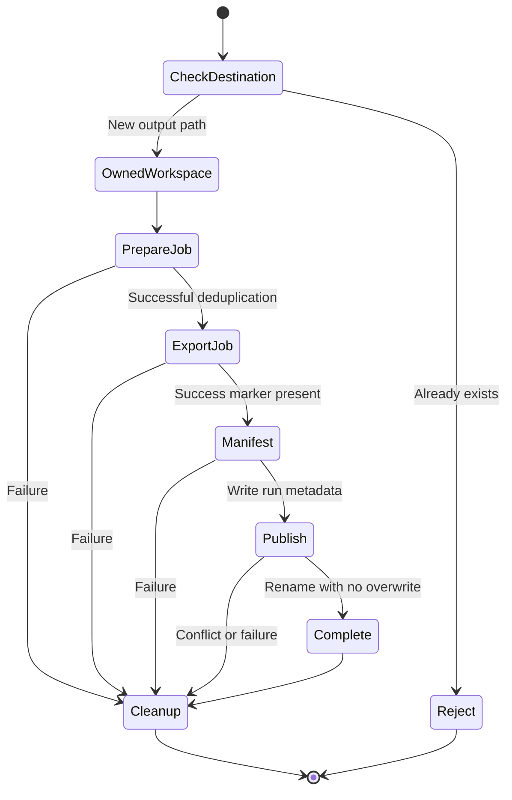

# Java/Hadoop architecture

## Job 1: prepare and globally deduplicate

`DocumentInputFormat` exposes raw bytes and offsets to map tasks. Line mode is splittable for uncompressed files; the first reader after a split boundary discards only the preceding partial line. Whole-file mode and compressed files use one split per file. Both readers retain at most the configured input-byte bound plus one byte. Oversized records are represented by a rejection marker, never a truncated training document. UTF-8 decoding is strict.

Each map task extracts text, normalizes it, applies common-pattern redaction, and evaluates quality rules. Accepted text is keyed by its SHA-256 digest. Source provenance is a hash of the qualified input path plus a byte offset. For compressed line input, the offset refers to decompressed bytes; whole-file documents use zero.

The combiner and reducer merge `PreparedDocumentWritable` values. State contains prepared text, source identity/offset, occurrence count, and five redaction counts. Counts add with overflow checks. The representative is the lexicographically smallest source ID, then smallest offset. This makes provenance independent of record arrival order. The reducer verifies that values under one digest contain identical text, then writes one SequenceFile record per unique document.

A combiner can execute zero or multiple times; it is an optimization, not a correctness requirement. A reducer streams duplicate occurrences and keeps one representative, rather than retaining an entire duplicate group. Exact deduplication happens across all input files, not just inside a mapper.

## Job 2: tokenize and export

A map-only job reads prepared SequenceFiles. The lexical tokenizer preserves case, punctuation, accented letters, atomic redaction tags and individual Han characters. A bounded deque maintains the chunk window. After emitting a full window, it retains the configured overlap; it does not emit a final chunk containing only already-exported overlap.

Chunk IDs hash the document ID, chunk index, and schema/tokenizer/window fingerprint. Input paths, reducer counts and compression do not enter this identity. The document digest determines train/validation membership before chunks are written, so one normalized document cannot cross splits. A configurable percentage chooses buckets from the first 64 digest bits modulo 100.

`MultipleOutputs` writes independent train/validation JSONL shards through a custom output format. Gzip is optional. This stage has no reducer and avoids another shuffle. The custom `train_chunks`, `validation_chunks` and `tokens_written` counters describe its exported records; the framework's ordinary `MAP_OUTPUT_RECORDS` can be zero because named outputs bypass the default writer.

## Output publication

All stage outputs live under a hidden UUID-named sibling workspace. The driver publishes only the completed export directory, after writing its manifest. `FileContext.rename(..., Rename.NONE)` refuses an existing destination. Local filesystem and HDFS are supported; object-store rename semantics are not assumed. Cleanup deletes only the invocation's owned workspace. A hard process kill can leave an orphan workspace but does not make an incomplete requested destination visible.

## Distributed placement and resource use

Input files and HDFS block/split sizes determine the first job's map parallelism. SHA-256 keys spread unique documents across the configured reducers. The second job reads the resulting SequenceFiles and can split large intermediates into map tasks. YARN allocates containers, while HDFS provides replicated input and output storage. The client orchestrates jobs and reads counters; workers process the text.

Processing costs are approximately linear in input bytes and emitted tokens, plus the deduplication shuffle. The design bounds individual documents and chunk state. It does not implement near-duplicate clustering, global document sorting, model tokenization, or streaming ingestion. Many tiny input files still incur Hadoop scheduling overhead; group short documents into line-based shards for throughput.

`ClusterAudit` independently checks the two completed YARN job IDs through JobHistoryServer, enumerates successful task attempts, and compares their hosts with ResourceManager's RUNNING workers. The demo audit fails if tasks did not execute successfully on at least two workers. This validates distributed process placement on the demo host, not multi-machine speedup or production availability.
