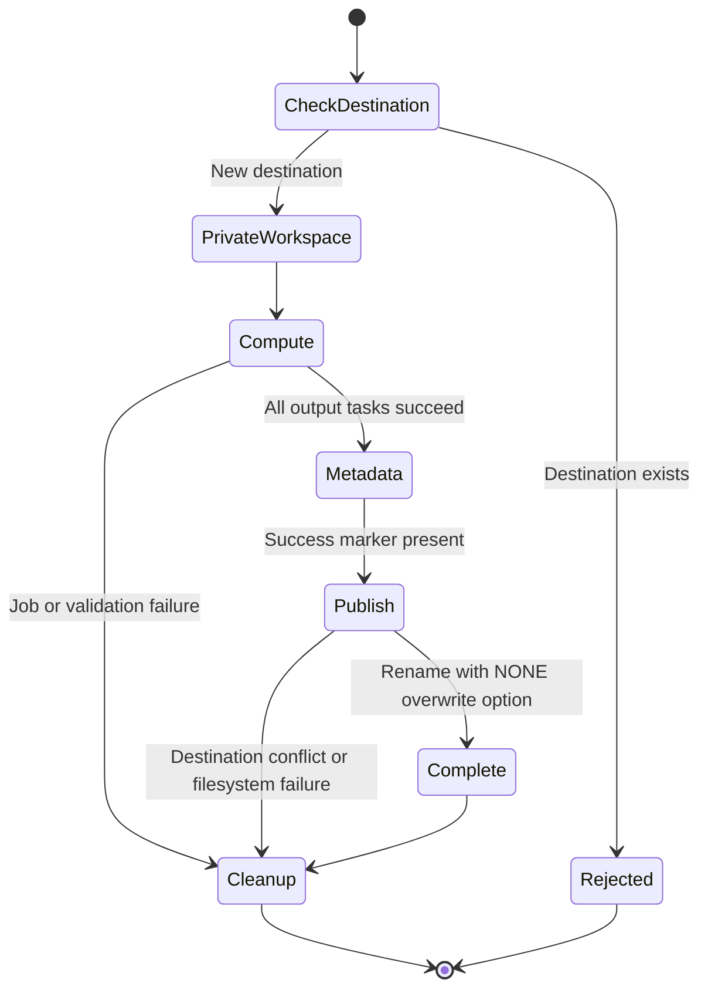

# Design notes

## Execution and shared semantics

The project uses one Maven build, with Java packages for domain logic and MapReduce jobs, and Scala packages for Spark transformations. The engines share parsing, CSV escaping, statistics formatting, tokenization, top-K ordering, and output publication. They independently implement the distributed transformations. Tests also use a small driver-side reference calculation that compares movies directly, rather than repeating the engines' user-side join.

The wide input schema deliberately preserves the original exercises. A movie row is fully parsed before any rating can be emitted. Empty cells retain their user positions. Rejecting a late invalid field therefore cannot leak earlier cells into an aggregate.

`--bad-records fail` aborts computation. `skip` discards the whole bad row. Hadoop counts committed task counters; Spark derives counts from persisted validated input rather than accumulators, so task recomputation does not inflate logical input-quality counts. A separate up-front count also records all raw input lines.

## Aggregation

Movie statistics use `(count, sum, min, max)` as mergeable state. Integers travel through the shuffle, and the mean is calculated only when rendering the final record. Empty states are identities. Both engines use checked additions for counts and sums.

Hadoop's `StatsWritable` serializes two longs and two ints, or 24 payload bytes per state, excluding framework key/record overhead. `StatsCombiner` merges that state; count tasks use a long-sum combiner. Word count and per-user activity benefit from repeated keys within map tasks. A combiner is an optional optimization; correctness does not require it to execute.

Spark uses `reduceByKey` for associative counts and statistics. `top-raters` reduces maximum-score/user-set states. Hadoop filters each row to its maximum-score users before shuffling, then merges ties in its reducer.

## Agreement join

For each input rating `(movie, user, score)`, emit `user → (movie, score)`. The first shuffle brings together movies rated by a user. Divide that user's movies into equal-score groups and emit unordered title pairs inside each group. Canonical title ordering ensures that `(A, B)` and `(B, A)` share the same key.

For a movie pair, support is:

```text
support(A, B) = number of users u where rating(u, A) = rating(u, B)
```

This counts agreement at any score, including low scores. It does not mean the user liked both movies. Pairs with no equal-score users are absent. A second shuffle sums contributions, then applies `--min-support`.

Hadoop stores first-stage output as SequenceFiles of `Text → LongWritable`, avoiding CSV reparsing between those jobs. Spark uses pair RDDs and `combineByKey` for user-side state, with a limit check on each insertion and merge. Both implementations reject duplicate titles in one user's join state and fail if that state exceeds `--max-movies-per-user`.

## Ranking

Qualifying pair counts become directed edges in both directions. `TopK` keeps a worst-first heap of at most K candidates per source movie. Higher support ranks first; equal support uses Java string title order. The final output includes rank explicitly.

For N candidates belonging to a source movie, selection costs `O(N log K)` time and `O(K)` state. Spark combines bounded heaps before and after shuffle; Hadoop streams candidates through a reducer heap. No complete neighbor list is collected on the driver.

## Complexity and limits

Let R be the number of observed ratings and d(u) the movies rated by user u. Parsing and basic statistics are linear in input size. User-side join state is `O(d(u))`. If d(u,s) movies receive score s from user u, the emitted contribution count is:

```text
sum over users u, scores s: d(u,s) * (d(u,s) - 1) / 2
```

This remains quadratic for dense users. The configurable guard fails visibly rather than silently truncating data. It bounds retained join state, but is not a guarantee that pair generation is cheap. A small fixture or sparse synthetic workload is appropriate for a laptop. Hadoop's local runner is a correctness/demo environment, not a multi-node performance benchmark.

The wide CSV format is inefficient for very large user populations and is unsuitable for unbounded streams. A practical extension would use long-form events in a columnar format with explicit identities and a separate data-quality job. Those extensions are not implemented or advertised as current features.

## Publication protocol



Every invocation writes into a hidden UUID-named sibling workspace. Intermediate stages and the final result live inside that owned workspace. Publication requires `_SUCCESS`, writes `_RUN.json`, and calls Hadoop `FileContext.rename` with `Rename.NONE`. This avoids the directory-moving behavior of a plain rename into an existing destination. Cleanup only removes the invocation's own workspace.

The supported publication model is a local filesystem or HDFS on the same filesystem as the destination. It relies on that filesystem's rename behavior; object stores are not covered. A process killed before cleanup can leave an orphan workspace, but a successful result is published only after computation and metadata writing finish. The code does not implement a transactional catalog, exactly-once ingestion, or cross-filesystem commits.
